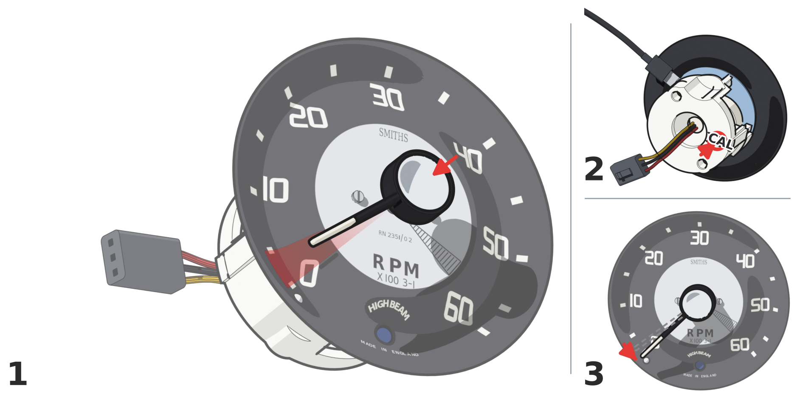

# Fitting the needle

Fitting the needle is the one setting-up job you do. Nothing is typed, measured or adjusted. You press a button
twice and push the needle on in between.

Before you start, the faceplate must be on the module (step 10 in the manual) and the needle's hub must already be
bored to fit (step 8).

## How do I power the module?

Use whichever is nearest. Either one works the same way.

- **USB-C.** Plug a USB-C cable into the USB-C socket on the module's board. The other end can go into a PC, a
  phone charger or a power bank. It is only used for power. Nothing runs on the computer.
- **The car.** If you have already wired the car side, plug the module into the pigtail's connector and turn the
  key on.

## What are the steps?

1. **Press CAL once**, then wait a second. The CAL button is on the back of the module (step 11).
2. **Push the needle on** so it points between the **0** and **5** marks (step 12). It does not have to be exact.
   Push it on firmly.
3. **Press CAL again.** The needle drives back to 0 and rests on the zero pin.

That is it. The needle is now set.

{ .booklet-pic }

## How do I know it worked?

Watch the needle. When you press CAL the second time, it drives to 0. The module has small lights on it, but you
cannot see them with the faceplate fitted, so the needle is the only thing to watch.

## Can I do it again?

Yes. Lift the needle off with a fork, the same way you took the old one off (step 6), and repeat the three steps
above.
