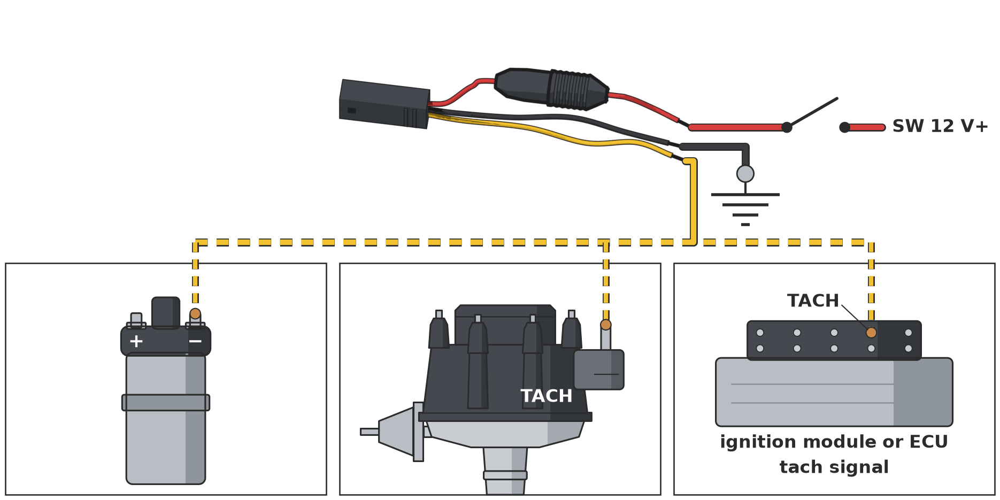

# Wiring

The kit comes with a short lead called the pigtail. One end has a plug that mates with the plug on the gauge's own
leads. The other end has three bare wires. These three wires are the only wiring you ever touch. You never solder
to the gauge or open the module.

Wire the car side first, before you open the gauge (step 3 in the manual). Then the car can power the module when
you fit the needle.

{ .booklet-pic }

## What are the three wires?

| Wire | Goes to |
|---|---|
| **Red** | Switched 12 V+: a 12 V feed that is on only when the key is on. It runs through the inline fuse holder (a 2 A glass fuse). |
| **Black** | Ground. In the manual's diagram it goes to battery negative. |
| **Yellow** | The tach signal, from **any one** of the sources below. |

!!! warning "Before you connect anything"
    **Negative-ground cars only.** A 1959 Sprite was positive earth when it left the factory; if yours has not been converted to negative earth, do not fit the kit.

    The 12 V must switch off with the key. Leave the fuse in the pigtail.

These are the kit's own colours, not the car's. To find the matching wires on your car, check your car's wiring
diagram.

## Where can the tach signal come from?

The yellow wire goes to **one** of these. You do not need to set anything on the gauge for the type of source.

- **The ignition coil's negative (−) terminal.** Works with points or with electronic ignition.
- **The TACH terminal of an HEI module.**
- **The tach output of an ignition module or an engine computer (ECU).** Either a 12 V or a 5 V signal is fine.

The gauge does not read the alternator's W terminal or a raw sensor pickup (a VR sensor). Use one of the sources
above.

## Is there anything to set on the gauge?

Yes, one thing: the cylinder switch on the back of the module. Set it to 4, 6 or 8 to match your engine (step 9 in
the manual). The Sprite's engine has four cylinders, so on a Sprite it goes on **4**.
